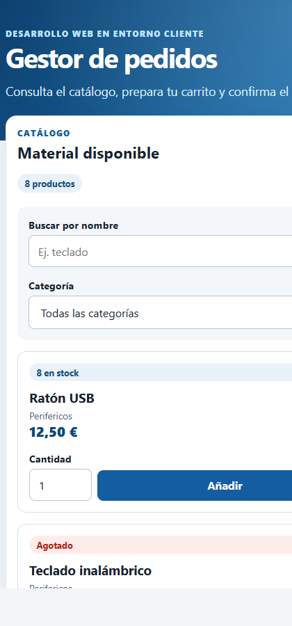
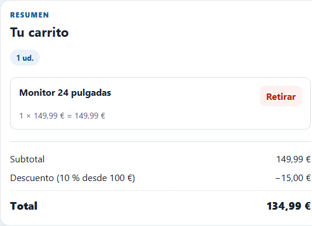
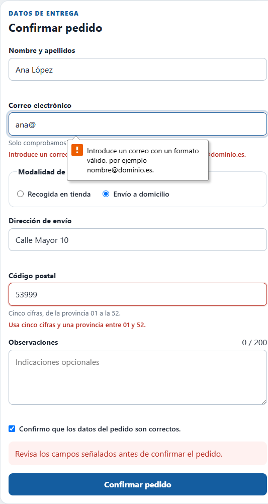
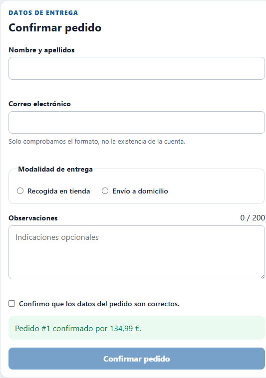
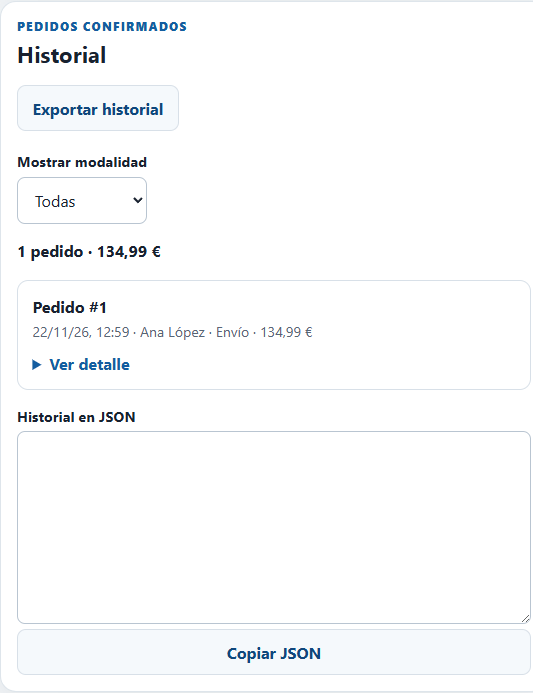
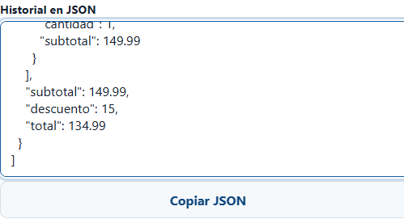
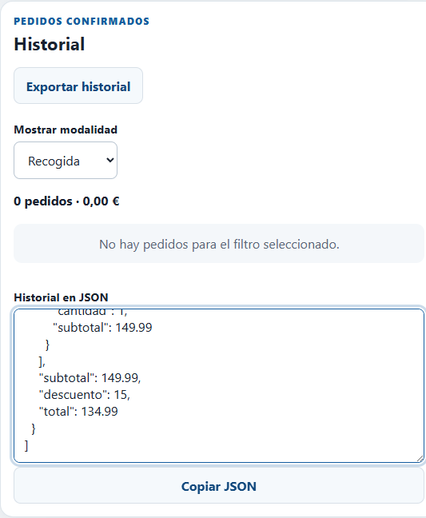
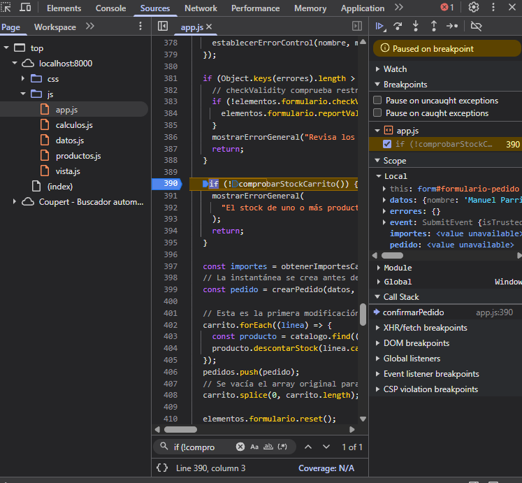
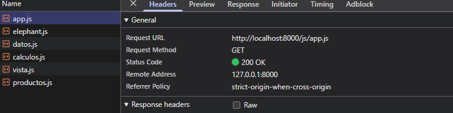

# Gestor de pedidos de material

Aplicación de cliente hecha con HTML, CSS y JavaScript. Permite buscar productos,
preparar un carrito, confirmar pedidos y consultar un historial temporal. Los datos
se guardan únicamente en memoria y desaparecen al recargar la página.

## Ejecutar la aplicación

Los módulos ES de JavaScript no deben abrirse con `file://`. Hay que servir la
carpeta mediante HTTP para que el navegador permita cargar los módulos con sus
cabeceras correctas.

Desde la raíz del proyecto:

```bash
python -m http.server 8000
```

Después se abre <http://localhost:8000>. También se puede usar la extensión Live
Server de VS Code o cualquier servidor equivalente.

## Estructura

```text
gestor-pedidos/
├── index.html
├── css/
│   └── estilos.css
├── js/
│   ├── app.js
│   ├── calculos.js
│   ├── datos.js
│   ├── productos.js
│   └── vista.js
└── README.md
```

- `index.html`: estructura de catálogo, carrito, formulario e historial.
- `css/estilos.css`: estilos responsivos, estados de error y layout.
- `js/productos.js`: clase `Producto` y sus métodos `hayDisponibilidad` y
  `descontarStock`.
- `js/datos.js`: catálogo creado con instancias de `Producto` y arrays
  `carrito` y `pedidos`.
- `js/calculos.js`: cálculos económicos y `validarDatosPedido`. Son funciones
  puras que no leen ni modifican el DOM.
- `js/vista.js`: creación y actualización segura del DOM con `createElement`,
  `textContent` y `replaceChildren`.
- `js/app.js`: eventos, filtros, carrito, validación completa, confirmación y
  exportación.

## Funcionalidades principales

### Modelo y catálogo

El catálogo se carga con ocho instancias de `Producto` de cuatro categorías. El
identificador no depende de la posición: se busca siempre con `find`. Hay un
producto agotado para probar ese estado.

La búsqueda no distingue mayúsculas y el filtro de categoría se combina con el
texto. Las tarjetas se crean en `crearTarjetaProducto` sin usar `innerHTML` con
datos dinámicos, por lo que el contenido se trata como texto y no como código.

### Carrito

`anadirAlCarrito` comprueba que la cantidad sea entera, positiva y no supere el
stock. Si el producto ya tiene una línea, suma la cantidad. Añadir al carrito no
descuenta existencias.

Los botones de retirada se controlan con un único evento `click` en
`lineas-carrito`. Se usa `event.target.closest(...)` para localizar el botón
dinámico y `splice` para eliminar la línea.

### Cálculos

- `calcularSubtotal(carrito, catalogo)`: suma precio por cantidad.
- `calcularDescuento(subtotal, porcentaje = 10)`: devuelve un 10 % cuando el
  subtotal es igual o superior a 100 €.
- `calcularTotal(subtotal, descuento)`: resta el descuento sin redondear.

Los números se mantienen como números hasta `formatearMoneda`, que muestra dos
decimales. `toFixed` no se utiliza para seguir calculando, porque convierte los
datos en cadenas.

El descuento y el total se redondean a céntimos con `Math.round(importe * 100) /
100` (función interna `redondearACentimos`). Esto evita el ruido típico de la
coma flotante en JavaScript: sin ese redondeo, `149.99 * 0.10` da
`14.999000000000002` en vez de `15`. El resultado sigue siendo un número, no una
cadena, así que puede seguir usándose en más cálculos.

### Formulario

El formulario usa `novalidate` para coordinar HTML5 y JavaScript desde el evento
`submit`. Se accede a los controles con `form.elements`, se recogen los datos con
`FormData` y se aplican `validity`, `setCustomValidity`, `checkValidity` y
`reportValidity`.

Los campos postales solo están habilitados para envío. La expresión regular del
código postal admite cinco cifras con provincia entre 01 y 52:

```js
/^(?:(?:0[1-9]|[1-4][0-9]|5[0-2])[0-9]{3})$/;
```

La validación JavaScript se vuelve a realizar completa al enviar. El contador de
observaciones se actualiza durante la edición.

### Confirmación e historial

Antes de modificar datos se valida todo el carrito y el formulario. Si es correcto:

1. se preparan copias con nombre, precio y subtotal de cada línea;
2. se descuenta el stock;
3. se añade el pedido al historial;
4. se vacía el carrito;
5. se repintan catálogo, carrito e historial.

Al guardar precios y nombres como valores, los pedidos antiguos no cambian si el
catálogo cambia más adelante. El historial puede filtrarse por modalidad y su
resumen suma solo los pedidos filtrados. «Exportar historial» muestra un JSON con
`JSON.stringify(pedidos, null, 2)`.

## Casos de prueba obligatorios

Todas estas pruebas parten de una recarga de la página, salvo que se indique
expresamente continuar con el caso anterior.

| #   | Caso                                | Pasos y datos                                                                                                          | Resultado esperado                                                                                                   |
| --- | ----------------------------------- | ---------------------------------------------------------------------------------------------------------------------- | -------------------------------------------------------------------------------------------------------------------- |
| 1   | Carrito vacío                       | Abrir la página sin añadir productos.                                                                                  | Se muestra «El carrito está vacío», los importes son 0,00 € y confirmar está deshabilitado.                          |
| 2   | Producto agotado                    | Buscar `Teclado inalámbrico`.                                                                                          | Se muestra como agotado; cantidad y botón no se pueden usar.                                                         |
| 3   | Cantidad inválida                   | En Ratón USB escribir `0`, `1.5` o dejar vacío y pulsar Añadir.                                                        | Se rechaza la entrada; no aparece una línea nueva.                                                                   |
| 4   | Stock insuficiente                  | En Ratón USB, con 8 unidades disponibles, intentar añadir 9; después añadir 5 y volver a añadir 5.                     | Ambos intentos que superan 8 se rechazan. La primera suma válida conserva una sola línea.                            |
| 5   | Suma de cantidades                  | Añadir 2 Ratones USB y después añadir otros 3 del mismo producto.                                                      | Hay una sola línea del ratón con cantidad 5 y subtotal 62,50 €.                                                      |
| 6   | Retirada de líneas                  | Con al menos una línea en el carrito, pulsar Retirar.                                                                  | Desaparece la línea; si era la última, vuelve el estado vacío.                                                       |
| 7   | Umbral de 100 €                     | Añadir 1 Monitor de 149,99 €.                                                                                          | Subtotal 149,99 €, descuento 15,00 € y total 134,99 €. Son valores exactos: `calcularDescuento` redondea a céntimos. |
| 8   | Correo inválido                     | Añadir un producto, rellenar nombre `Ana López`, seleccionar recogida, marcar aceptación y escribir `ana@`. Confirmar. | Se señala el correo y no se vacía el carrito ni se modifica el stock.                                                |
| 9   | Código postal inválido              | Seleccionar envío y probar `00999`, `53001`, `2800` y `28001x`.                                                        | Los cuatro formatos se rechazan; `28001` se acepta.                                                                  |
| 10  | Cambio de modalidad                 | Elegir envío, dejar dirección/CP con error y cambiar a recogida.                                                       | Los campos postales desaparecen, dejan de ser obligatorios y sus errores personalizados se borran.                   |
| 11  | Pedido y copia de precios           | Confirmar 1 Monitor con datos válidos. Buscar de nuevo el producto.                                                    | Se descuenta una existencia, el carrito se vacía y el historial muestra el precio de ese momento.                    |
| 12  | Historial y filtro sin resultados   | Tras crear un pedido de recogida, elegir `Envío` en el filtro del historial.                                           | El estado vacío aparece y el resumen muestra 0 pedidos · 0,00 €, sin `NaN` ni `Infinity`.                            |
| 13  | Filtros del catálogo sin resultados | Categoría `oficina` y búsqueda `monitor`.                                                                              | Aparece el mensaje de que no hay coincidencias.                                                                      |
| 14  | Exportación                         | Crear un pedido y pulsar Exportar historial.                                                                           | Aparece un textarea con JSON válido y copiable que contiene los datos y líneas del pedido.                           |

### Pruebas rápidas de funciones puras

Desde la consola se puede comprobar el descuento sin tocar la interfaz:

```js
const descuentoBajo = window.gestorPedidos.calcularDescuento(99.99);
const descuentoAlto = window.gestorPedidos.calcularDescuento(100);
console.log(descuentoBajo, descuentoAlto); // 0 10
```

La clase se puede inspeccionar con el catálogo expuesto para la práctica:

```js
const raton = window.gestorPedidos.catalogo.find((p) => p.id === 101);
console.log(raton.hayDisponibilidad(8)); // true
console.log(raton.hayDisponibilidad(9)); // false
```

## Evidencias (capturas de pantalla)

Las capturas viven en la carpeta [`capturas/`](./capturas) y se generaron
sirviendo la aplicación por HTTP, sin modificar manualmente ningún dato: son el
resultado real de usar la interfaz. Cada una corresponde a uno o varios casos de
la tabla anterior.

| Captura                                                                        | Qué muestra                                                                                                                          | Casos relacionados |
| ------------------------------------------------------------------------------ | ------------------------------------------------------------------------------------------------------------------------------------ | ------------------ |
|                         | Catálogo recién cargado, carrito vacío y el Teclado inalámbrico marcado como agotado.                                                | 1, 2               |
|               | Carrito con 1 Monitor: subtotal 149,99 €, descuento −15,00 € y total 134,99 €.                                                       | 7                  |
|                 | Aviso nativo de formato de correo y error personalizado del código postal (provincia fuera de 01–52).                                | 8, 9               |
|                       | Mensaje «Pedido #1 confirmado por 134,99 €.» tras corregir los datos y confirmar.                                                    | 11                 |
|                   | Entrada del historial con el desplegable «Ver detalle» abierto mostrando la línea comprada.                                          | 11                 |
|                            | Resultado de `JSON.stringify(pedidos, null, 2)`: `"subtotal": 149.99, "descuento": 15, "total": 134.99`, sin ruido de coma flotante. | 14                 |
|  | Filtro «Recogida» sobre un historial que solo tiene un pedido de envío: `0 pedidos · 0,00 €`, sin `NaN`.                             | 12                 |
|                  | DevTools pausado en `if (!comprobarStockCarrito())`, con `carrito`, `datos` e `importes` visibles en el panel Scope → Local.         | —                  |
|              | Petición `GET http://localhost:8000/js/app.js` con `Status Code: 200 OK`, confirmando la carga por HTTP.                             | —                  |

## Depuración con DevTools

Estas dos evidencias se hicieron a mano en el navegador, porque es la
herramienta que hay que saber usar para la exposición oral. Los pasos seguidos
para reproducirlas, por si se repiten en directo durante la defensa:

### Punto de interrupción (`capturas/08-breakpoint-sources.png`)

1. Sirve el proyecto por HTTP (ver «Ejecutar la aplicación») y abre
   `http://localhost:8000` en Chrome o Edge.
2. Abre DevTools con `F12` y ve a la pestaña **Sources**.
3. En el árbol de archivos de la izquierda, navega hasta `localhost:8000 → js →
app.js` y ábrelo.
4. Busca la función `confirmarPedido` y haz clic en el número de línea de
   `if (!comprobarStockCarrito()) {` para fijar un punto de interrupción (el
   número se marca en azul).
5. Vuelve a la página, añade al carrito el Monitor 24 pulgadas (o cualquier
   producto con stock), rellena el formulario con datos válidos (modalidad
   recogida es la más rápida) y pulsa **Confirmar pedido**.
6. La ejecución se detiene en tu breakpoint. En el panel **Scope** (columna
   derecha), despliega `Local` y comprueba:
   - `carrito` todavía tiene la línea añadida (no se ha vaciado).
   - La variable `importes` ya tiene `subtotal`, `descuento` y `total`
     calculados.
   - Si abres la pestaña **Console** sin cerrar la pausa, puedes escribir
     `carrito` y `catalogo.find(p => p.id === 208).stock` para comprobar que el
     stock **todavía no** se ha descontado.
7. Haz la captura de pantalla completa de DevTools en este momento (con el
   código resaltado en amarillo, el breakpoint marcado y el panel Scope
   visible) y guárdala como `capturas/08-breakpoint-sources.png`.
8. Pulsa `F8` (o el botón de reanudar) para continuar y comprueba que el pedido
   se confirma con normalidad.

Esta pausa evidencia la regla «comprobar todo antes de modificar nada»: en el
momento del breakpoint ya se sabe que el pedido es válido, pero el stock y el
carrito todavía no se han tocado.

### Pestaña Network (`capturas/09-network-app-js.png`)

1. Con la página ya abierta, ve a la pestaña **Network** de DevTools.
2. Marca la casilla **Disable cache** (para forzar peticiones nuevas) y recarga
   con `Ctrl+Shift+R`.
3. En la lista de peticiones, haz clic en la fila `app.js`.
4. En el panel de detalle, pestaña **Headers**, comprueba y deja visible:
   - **Request URL**: `http://localhost:8000/js/app.js`.
   - **Request Method**: `GET`.
   - **Status Code**: `200 OK`.
5. Haz la captura con la lista de peticiones y el panel de detalle de `app.js`
   visibles a la vez, y guárdala como `capturas/09-network-app-js.png`.

Esta comprobación evidencia que los módulos y el CSS se cargan desde el
servidor HTTP local (no mediante `file://`) y permite detectar errores 404 o
ficheros que no llegan a cargarse.

## Preguntas útiles para la defensa

- ¿Por qué `file://` no permite organizar cómodamente módulos y debe usarse HTTP?
- ¿Por qué un pedido copia nombre y precio en lugar de guardar la referencia al
  producto?
- ¿Qué método de `Producto` comprueba el stock y cuál lo modifica?
- ¿Qué diferencia hay entre `calcularTotal` y `actualizarCarrito`?
- ¿Por qué se comprueba el carrito otra vez al confirmar?
- ¿Qué ventaja tiene delegar la retirada de líneas?
- ¿Dónde se usa `FormData` y por qué no basta la validación HTML5?
